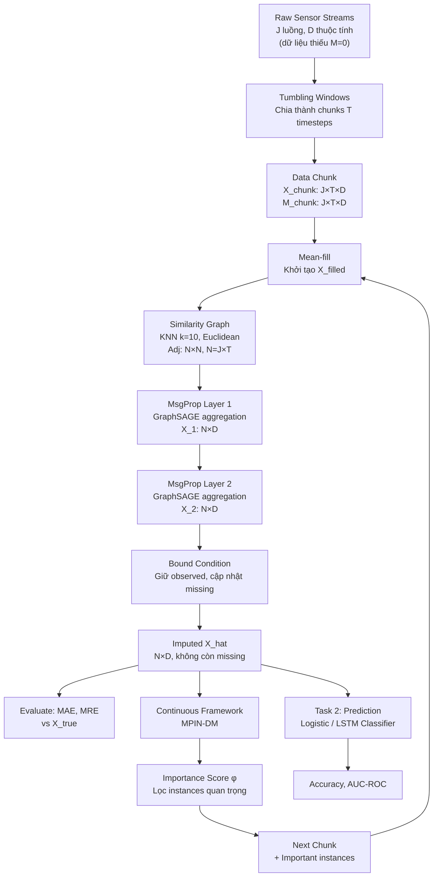

# 03 – Cách MPIN Hoạt Động: Giải Thích Kỹ Thuật Chi Tiết

---

## 1. Toàn Bộ Pipeline



---

## 2. Định Nghĩa Hình Thức

### 2.1 Dữ liệu đầu vào

Cho $J$ luồng dữ liệu (data streams), mỗi luồng là một thiết bị cảm biến đo $D$ thuộc tính theo thời gian. Trong cửa sổ thời gian độ dài $T$:

$$\mathbf{X} \in \mathbb{R}^{J \times T \times D}$$
$$\mathbf{M} \in \{0, 1\}^{J \times T \times D}$$

Trong đó $M_{j,t,d} = 1$ nếu giá trị $X_{j,t,d}$ được quan sát, $M_{j,t,d} = 0$ nếu bị thiếu.

### 2.2 Data Chunk (Instance matrix)

Mỗi cặp $(j, t)$ là một **instance** $i$. Flatten thành ma trận:

$$\mathbf{X}_{chunk} \in \mathbb{R}^{N \times D}, \quad N = J \cdot T$$
$$\mathbf{M}_{chunk} \in \{0, 1\}^{N \times D}$$

Với $i = (j-1) \cdot T + t$ là index của instance $(j, t)$.

---

## 3. Bước 1: Tumbling Window

**Tumbling window** (cửa sổ trượt không chồng lấp) chia dữ liệu liên tục thành các chunk không chồng lấp nhau:

```
Timeline: |--T--|--T--|--T--|--T--| ...
Chunk:       W1    W2    W3    W4
```

Mỗi chunk $W_k$ chứa dữ liệu từ timestamp $t_{start}$ đến $t_{start} + T - 1$.

**Lý do dùng tumbling window**:
- Đơn giản, không có data leakage giữa các chunk.
- Phù hợp với streaming (xử lý real-time theo từng batch).
- Phân biệt rõ dữ liệu "hiện tại" và "lịch sử".

---

## 4. Bước 2: Khởi Tạo Mean-Fill

Trước khi tính khoảng cách, cần có giá trị tại tất cả vị trí. MPIN dùng mean-fill đơn giản:

$$\tilde{x}_{i,d} = \begin{cases} x_{i,d} & \text{nếu } m_{i,d} = 1 \\ \bar{x}_d & \text{nếu } m_{i,d} = 0 \end{cases}$$

Trong đó $\bar{x}_d = \frac{\sum_{i: m_{i,d}=1} x_{i,d}}{|\{i: m_{i,d}=1\}|}$ là mean của thuộc tính $d$ trên các giá trị quan sát được.

> **Lưu ý**: Mean-fill chỉ dùng để xây dựng đồ thị (tính khoảng cách), **không** phải imputation cuối cùng. Imputation chính xác được thực hiện bởi MPIN.

---

## 5. Bước 3: Xây Dựng Similarity Graph

### 5.1 Thuật toán xây dựng đồ thị

```
Input: X_filled ∈ ℝ^{N×D}  (sau mean-fill)
Output: Adjacency matrix Adj ∈ {0,1}^{N×N}

1. Tính pairwise distance:
   dist[i,k] = ||X_filled[i] - X_filled[k]||_2
   → Ma trận khoảng cách D ∈ ℝ^{N×N}

2. Với mỗi node i, lấy K láng giềng gần nhất:
   N(i) = argsort(D[i,:])[1:K+1]  # bỏ chính nó (index 0)

3. Tạo đồ thị vô hướng:
   Adj[i,k] = 1  nếu k ∈ N(i) hoặc i ∈ N(k)
   Adj[i,k] = 0  ngược lại
```

**Công thức khoảng cách Euclidean**:

$$\text{dist}(i, k) = \sqrt{\sum_{d=1}^{D} (\tilde{x}_{i,d} - \tilde{x}_{k,d})^2}$$

**Lý do chọn Euclidean và K=10**:
- Euclidean phù hợp cho dữ liệu continuous đã normalize.
- K=10 cân bằng giữa: đủ láng giềng để học (connectivity) và không quá dense (noise).

### 5.2 Ý nghĩa của đồ thị

Hai node $i$ và $k$ có cạnh nối nếu chúng "tương đồng" – tức là các thuộc tính quan sát được của chúng có giá trị gần nhau. Điều này nghĩa là: **nếu node $i$ bị thiếu thuộc tính $d$, node $k$ có thể là nguồn thông tin tốt để ước lượng giá trị đó**.

---

## 6. Bước 4: Message Propagation Layer (MsgProp)

### 6.1 Công thức cốt lõi

Mỗi lớp MsgProp cập nhật biểu diễn của node $i$:

$$\tilde{\mathbf{x}}_i^{(l+1)} = \sum_{k \in \mathcal{N}(i)} c\!\left(\mathbf{x}_i^{(l)}, \mathbf{x}_k^{(l)}\right) \cdot \mathbf{x}_k^{(l)} \cdot \mathbf{W}^{(l)}$$

Trong đó:
- $\mathcal{N}(i)$: tập láng giềng của node $i$ trong đồ thị
- $c(\mathbf{x}_i, \mathbf{x}_k)$: **correlation weight** (trọng số tương quan) – học được
- $\mathbf{W}^{(l)} \in \mathbb{R}^{D \times D}$: ma trận trọng số học được của lớp $l$
- $l$: chỉ số lớp (0, 1 với 2-layer MPIN)

### 6.2 Correlation Weight

Trọng số $c(\mathbf{x}_i, \mathbf{x}_k)$ phản ánh mức độ tương đồng giữa hai nodes:

$$c(\mathbf{x}_i, \mathbf{x}_k) = \text{softmax}_k\!\left(\frac{\mathbf{a}^T [\mathbf{x}_i \| \mathbf{x}_k]}{\sqrt{D}}\right)$$

Trong đó $\mathbf{a}$ là vector attention học được, $\|$ là concatenation. Softmax đảm bảo tổng trọng số = 1 và $c(\cdot, \cdot) \geq 0$.

**Trực quan**: Node $k$ có nhiều thuộc tính tương đồng với node $i$ sẽ có trọng số cao hơn → đóng góp nhiều hơn vào việc điền giá trị cho $i$.

### 6.3 Bound Condition (Ràng buộc bảo toàn)

Sau mỗi lớp, chỉ cập nhật các vị trí **bị thiếu**; giữ nguyên các vị trí **đã quan sát**:

$$x_{i,d}^{(l+1)} = \begin{cases} x_{i,d}^{(0)} & \text{nếu } m_{i,d} = 1 \quad \text{(observed: không thay đổi)} \\ \tilde{x}_{i,d}^{(l+1)} & \text{nếu } m_{i,d} = 0 \quad \text{(missing: cập nhật)} \end{cases}$$

**Lý do**: Đảm bảo rằng MPIN không làm hỏng dữ liệu đã có sẵn – chỉ bổ sung thông tin cho vị trí thiếu.

### 6.4 So Sánh với GraphSAGE

MPIN-MsgProp về cơ bản là biến thể của **GraphSAGE** (Hamilton et al., 2017):

| GraphSAGE | MPIN-MsgProp |
|-----------|-------------|
| $h_i = \sigma(W \cdot [h_i \| \text{MEAN}(\{h_k\})])$ | $\tilde{x}_i = \sum_k c(x_i, x_k) \cdot x_k \cdot W$ |
| Kết hợp self + aggregation | Chỉ aggregation từ láng giềng (với bound condition) |
| Cho graph classification | Cho imputation (feature-level) |

---

## 7. Bước 5: Training (Transductive Learning)

### 7.1 Chiến lược training

MPIN dùng **transductive learning**: train và infer trên cùng một chunk, không cần dữ liệu test riêng.

Chia chunk $X_{chunk}$ thành:
- **Observed positions** $\mathcal{O} = \{(i,d) : m_{i,d} = 1\}$: có nhãn
- **Missing positions** $\mathcal{M} = \{(i,d) : m_{i,d} = 0\}$: cần điền

### 7.2 Loss Function

Trong training, **giả vờ** một số vị trí observed là missing (validation split = 5%):

$$\mathcal{O}_{train} \cup \mathcal{O}_{val} = \mathcal{O}, \quad |\mathcal{O}_{val}| = 0.05 \cdot |\mathcal{O}|$$

Loss MSE trên validation set:

$$\mathcal{L} = \frac{1}{|\mathcal{O}_{val}|} \sum_{(i,d) \in \mathcal{O}_{val}} \left(\hat{x}_{i,d} - x_{i,d}\right)^2$$

Trong đó $\hat{x}_{i,d}$ là giá trị được MPIN ước lượng.

### 7.3 Optimization

```
Optimizer: Adam(lr=0.001, betas=(0.9, 0.999))
Epochs: 100
Scheduler: ReduceLROnPlateau (patience=10)
Early stopping: validation loss không cải thiện sau 20 epochs
```

---

## 8. Bước 6: Continuous Framework (MPIN-DM)

MPIN-DM (Dynamic Model) là phiên bản MPIN cho dữ liệu streaming thực tế, với hai cơ chế cập nhật:

### 8.1 Data Update

Khi chunk mới $W_{k+1}$ đến, không bỏ toàn bộ thông tin từ $W_k$. Lọc ra các **instances quan trọng** từ $W_k$ để bổ sung vào $W_{k+1}$.

**Importance Score** $\phi_i$ của instance $i$:

$$\phi_i = \frac{\sum_{d=1}^{D} m_{i,d}}{D} = \frac{\text{số thuộc tính quan sát được}}{D}$$

$\phi_i$ cao → instance $i$ có nhiều thông tin → quan trọng hơn.

**Lọc theo ngưỡng** $\eta = 0.6$:

$$\mathcal{I}_{important} = \{i \in W_k : \phi_i \geq \eta\}$$

**Chunk mới** = $W_{k+1} \cup \mathcal{I}_{important}$

**Lý do**: Instances đầy đủ thông tin từ quá khứ giúp xây dựng đồ thị tốt hơn và cung cấp thêm context cho các instances mới bị thiếu nhiều.

### 8.2 Model Update

Thay vì train MPIN từ đầu trên mỗi chunk mới (tốn thời gian), MPIN-DM dùng **transfer learning**:

1. Lấy model đã train trên $W_k$ làm điểm khởi đầu (warm-start).
2. Chỉ fine-tune **message passing module** (các lớp MsgProp) trên $W_{k+1}$.
3. Giữ nguyên các phần còn lại (similarity graph construction).

```
Model_{k+1} = fine_tune(Model_k, W_{k+1} ∪ I_important, epochs=20)
```

**Lợi ích**:
- Nhanh hơn nhiều so với train từ đầu.
- Giữ được "kiến thức" từ các chunk trước.
- Thích nghi với data drift theo thời gian.

---

## 9. Metrics Đánh Giá

### Mean Absolute Error (MAE)

$$\text{MAE} = \frac{1}{|\mathcal{M}|} \sum_{(i,d) \in \mathcal{M}} |\hat{x}_{i,d} - x_{i,d}^{true}|$$

### Mean Relative Error (MRE)

$$\text{MRE} = \frac{1}{|\mathcal{M}|} \sum_{(i,d) \in \mathcal{M}} \frac{|\hat{x}_{i,d} - x_{i,d}^{true}|}{|x_{i,d}^{true}| + \epsilon}$$

Trong đó $\epsilon$ là giá trị nhỏ tránh chia cho 0.

### Root Mean Squared Error (RMSE)

$$\text{RMSE} = \sqrt{\frac{1}{|\mathcal{M}|} \sum_{(i,d) \in \mathcal{M}} (\hat{x}_{i,d} - x_{i,d}^{true})^2}$$

> **Chú ý**: Tất cả metrics chỉ tính trên **vị trí thiếu** ($\mathcal{M}$), không phải toàn bộ ma trận.

---

## 10. Ví Dụ Minh Họa (từ Paper)

Từ bài báo MPIN, Example 1:

| Instance | Attr 1 | Attr 2 | Attr 3 | Mask (1=obs) |
|----------|--------|--------|--------|--------------|
| $x_2$ (target) | _ | 5 | 6 | [0, 1, 1] |
| $x_3$ (neighbor) | 8 | 5 | 3 | [1, 1, 1] |
| $x_4$ (neighbor) | 3 | 2 | 1 | [1, 1, 1] |

**Bước 1**: Mean-fill $x_2$: attr 1 = mean(8, 3) = 5.5

**Bước 2**: Tính distance:
- $\text{dist}(x_2, x_3) = \|(5.5, 5, 6) - (8, 5, 3)\|_2 = \sqrt{6.25 + 0 + 9} = 3.95$
- $\text{dist}(x_2, x_4) = \|(5.5, 5, 6) - (3, 2, 1)\|_2 = \sqrt{6.25 + 9 + 25} = 6.37$

**Bước 3**: $x_3$ là láng giềng gần hơn → weight $c(x_2, x_3) > c(x_2, x_4)$

**Bước 4**: MsgProp ước lượng attr 1 của $x_2$:
$$\hat{x}_{2,1} = c(x_2, x_3) \cdot x_{3,1} \cdot W + c(x_2, x_4) \cdot x_{4,1} \cdot W$$
$$\approx 0.7 \cdot 8 + 0.3 \cdot 3 = 5.6 + 0.9 = 6.5$$

**Kết quả**: $\hat{x}_{2,1} = 6.5$ (giá trị thực tế giả sử là 7 → error = 0.5).

---

*Xem demo tương tác trong `notebooks/02_mpin_demo.ipynb`*
