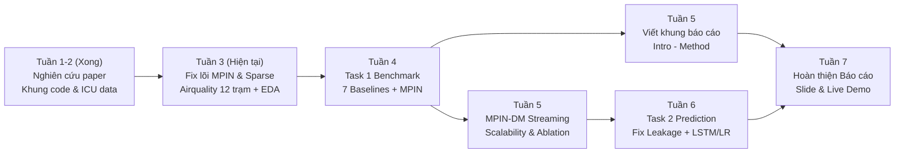

# 04 – Kế Hoạch Dự Án (7 Tuần – Cập Nhật Thực Tế)

---

## 1. Tổng Quan Lịch Trình

| Tuần | Thời gian | Chủ đề chính | Trạng thái |
|------|----------|-------------|------------|
| 1 | Tuần 1 | Nghiên cứu tài liệu, hiểu bài báo MPIN | Hoàn thành |
| 2 | Tuần 2 | Setup môi trường, dựng khung codebase & tải dữ liệu ICU | Hoàn thành |
| 3 | Tuần 3 | Hoàn thiện Multi-stream Data, Fix lõi & Vector hóa MPIN, EDA thật | Đang thực hiện |
| 4 | Tuần 4 | Benchmark Task 1 (Static Imputation) trên ICU & Airquality | Đã lên kế hoạch |
| 5 | Tuần 5 | Streaming (MPIN-DM), Scalability, Ablation & Khung báo cáo | Đã lên kế hoạch |
| 6 | Tuần 6 | Task 2 (Downstream Prediction) & Tổng hợp biểu đồ | Đã lên kế hoạch |
| 7 | Tuần 7 | Hoàn thiện báo cáo, slide, kịch bản demo & dọn repo | Đã lên kế hoạch |

---

## 2. Kế Hoạch Chi Tiết Từng Tuần

### Tuần 1 – Nghiên Cứu Tài Liệu *(Hoàn thành)*

**Mục tiêu**: Toàn nhóm hiểu rõ bài báo MPIN (VLDB 2023, arXiv:2311.07344) và bối cảnh 4 thách thức C1–C4.

| Hạng mục | Chi tiết |
|---------|---------|
| **Nhiệm vụ đã xong** | - Đọc bài báo MPIN, GraphSAGE và tổng hợp lý thuyết vào `doc/01_project_overview.md`, `doc/02_model_selection.md`, `doc/03_how_it_works.md` |
| | - Nắm vững cơ chế Similarity Graph, MsgProp, Bound Condition và MPIN-DM |
| **Deliverables** | - Bộ tài liệu tổng quan & lựa chọn mô hình trong `doc/` |

---

### Tuần 2 – Setup Môi Trường & Dựng Khung Codebase *(Hoàn thành)*

**Mục tiêu**: Dựng cấu trúc dự án, chuẩn bị môi trường và tải dữ liệu ban đầu.

| Hạng mục | Chi tiết |
|---------|---------|
| **Nhiệm vụ đã xong** | - Thiết lập `venv`, `requirements.txt`, `configs/config.yaml` và cấu trúc `src/`, `scripts/`, `tests/` |
| | - Tải và parse thành công dữ liệu ICU PhysioNet 2012 (Set A + Set B: 8,000 bệnh nhân) thành `data/processed/icu/` |
| | - Cài đặt khung code ban đầu cho `mpin.py`, `continuous_framework.py`, `baselines.py`, `predictor.py`, `run_imputation.py`, `run_prediction.py` |
| **Deliverables** | - Khung pipeline chạy được end-to-end trên dữ liệu mẫu |

---

### Tuần 3 – Hoàn Thiện Multi-Stream Data, Fix Lõi MPIN & EDA Thật *(Trọng tâm hiện tại)*

**Mục tiêu**: Sửa triệt để các lỗi thuật toán/hiệu năng đang khiến MPIN học sai trên thực tế, đồng thời chuẩn hóa dữ liệu đa luồng thật cho cả ICU và Airquality.

| Hạng mục | Chi tiết |
|---------|---------|
| **Nhiệm vụ** | 1. **Fix lõi thuật toán MPIN (`src/models/mpin.py`)**: |
| | &nbsp;&nbsp;&nbsp;• Tách *training reconstruction mask* (che ngẫu nhiên một phần vị trí observed để tính loss, tránh bound condition làm MSE loss/gradient bằng 0) |
| | &nbsp;&nbsp;&nbsp;• Bỏ `torch.no_grad()` khỏi `CorrelationAttention` để trọng số tương quan thực sự được học |
| | &nbsp;&nbsp;&nbsp;• Điều chỉnh kiến trúc MsgProp để không bị `LayerNorm` + `ReLU` cắt cụt giá trị âm/chuẩn hóa |
| | 2. **Vector hóa & Tối ưu hiệu năng**: |
| | &nbsp;&nbsp;&nbsp;• Thay vòng lặp `for i in range(N)` và ma trận kề đặc `(N, N)` bằng `edge_index` thưa (`O(E)` RAM) để scale lên hàng chục nghìn nodes |
| | &nbsp;&nbsp;&nbsp;• Sửa công thức MRE trong `src/evaluation/metrics.py` theo chuẩn paper ($\sum |\hat{x} - x| / \sum |x|$) |
| | 3. **Chuẩn hóa dữ liệu Airquality đa luồng**: |
| | &nbsp;&nbsp;&nbsp;• Chuyển từ `AirQualityUCI` (1 trạm, mất tính C2 – Concurrency) sang **Beijing Multi-Site Air-Quality** (12 trạm đo đồng thời, 11 thuộc tính) |
| | &nbsp;&nbsp;&nbsp;• Hoàn thiện `load_airquality_dataset` trong `src/data/loader.py` và cập nhật `scripts/download_data.py` |
| | 4. **EDA trên dữ liệu thật**: |
| | &nbsp;&nbsp;&nbsp;• Cập nhật `notebooks/01_data_exploration.ipynb` chạy trực tiếp trên ICU (8,000 streams) và Airquality (12 trạm) |
| | &nbsp;&nbsp;&nbsp;• Điền số liệu thống kê thực tế (missing rate từng thuộc tính, phân phối, heatmap) vào `doc/05_dataset_guide.md` |
| **Deliverables** | - MPIN vượt qua MEAN/KNN/FeaProp trên bài test kiểm chứng nhỏ (`--synthetic` & tập con ICU) |
| | - `data/processed/airquality/` sẵn sàng với $J = 12$ streams |
| | - Notebook EDA & thống kê dữ liệu thật hoàn chỉnh |
| **Rủi ro** | Code mới khác API cũ → Kiểm thử từng bước bằng `pytest tests/test_components.py` sau mỗi thay đổi |

---

### Tuần 4 – Chạy Thực Nghiệm Task 1 (Static Imputation Benchmark)

**Mục tiêu**: Có bảng kết quả MAE, MRE, RMSE chuẩn hóa và công bằng trên cả **ICU** và **Airquality** với đầy đủ baselines.

| Hạng mục | Chi tiết |
|---------|---------|
| **Nhiệm vụ** | 1. **Tích hợp Deep Learning Baselines**: Cài `pypots` vào `requirements.txt` và tích hợp **BRITS**, **SAITS** vào `src/models/baselines.py` & `src/evaluation/compare.py` |
| | 2. **Tối ưu Baseline truyền thống**: Thay vòng lặp `knn_imputation` bằng `sklearn.impute.KNNImputer` (hoặc vector hóa) để chạy được trên quy mô lớn |
| | 3. **Chạy benchmark ICU**: Chạy đủ 7 baselines (MEAN, KNN, MICE, MF, BRITS, SAITS, FeaProp) + MPIN qua nhiều random seeds (3–5 seeds) với các mức mask đánh giá (10%, 20%, 30%) |
| | 4. **Chạy benchmark Airquality**: Chạy đầy đủ các phương pháp trên bộ Beijing Multi-Site (12 trạm) |
| | 5. **Lưu kết quả & Biểu đồ**: Xuất CSV/JSON và vẽ bar chart so sánh vào `results/figures/` |
| **Deliverables** | - Bảng so sánh Task 1 đầy đủ (mean ± std) cho ICU & Airquality |
| | - `results/metrics/icu_all_results.csv` và `airquality_all_results.csv` |
| **Rủi ro** | Chạy full 8,000 bệnh nhân chậm trên CPU → Chạy thực nghiệm chính trên GPU (Google Colab / Kaggle), lưu checkpoint & logs |

---

### Tuần 5 – Streaming (MPIN-DM), Big Data Scalability & Khung Báo Cáo

**Mục tiêu**: Chứng minh năng lực xử lý luồng liên tục (streaming) và mở rộng quy mô dữ liệu lớn (Big Data) của MPIN-DM, đồng thời khởi tạo báo cáo sớm.

| Hạng mục | Chi tiết |
|---------|---------|
| **Nhiệm vụ** | 1. **Hoàn thiện pipeline MPIN-DM**: Nối `MPINcontinuous` (`src/models/continuous_framework.py`) vào nhánh `--method mpin_dm` trong `scripts/run_imputation.py` |
| | 2. **Thực nghiệm Streaming**: So sánh Static MPIN (train lại từ đầu mỗi window) vs MPIN-DM (Data Update $\phi \ge \eta$ + Warm-start Model Update) về độ chính xác (MAE/MRE) và tốc độ xử lý |
| | 3. **Thực nghiệm Scalability (Big Data)**: Đo thời gian xử lý/window và mức tiêu thụ RAM khi tăng dần số luồng $J$ (ví dụ: 100 → 1,000 → 4,000 → 8,000) |
| | 4. **Ablation & Sensitivity Analysis**: Khảo sát ảnh hưởng của $K$ (KNN neighbors), số lớp MsgProp, và ngưỡng $\eta$ (`0.4, 0.6, 0.8`) |
| | 5. **Viết khung báo cáo (LaTeX/Overleaf)**: Hoàn thành trước các phần Introduction, Problem Formulation, Related Work, và Methodology |
| **Deliverables** | - Kết quả thực nghiệm MPIN vs MPIN-DM & biểu đồ Scalability |
| | - Phân tích độ nhạy hyperparameter |
| | - Bản nháp 60% báo cáo (Introduction → Method) |
| **Rủi ro** | Tràn bộ nhớ khi $J = 8,000$ → Điều chỉnh `window_size` hoặc batch/subgraph sampling theo hướng dẫn bài báo |

---

### Tuần 6 – Task 2: Downstream Prediction & Tổng Hợp Biểu Đồ

**Mục tiêu**: Kiểm chứng giả thuyết *imputation tốt hơn giúp mô hình dự đoán ICU mortality chính xác hơn*, đảm bảo quy trình không bị data leakage.

| Hạng mục | Chi tiết |
|---------|---------|
| **Nhiệm vụ** | 1. **Fix Data Leakage trong `scripts/run_prediction.py`**: |
| | &nbsp;&nbsp;&nbsp;• Chia `train/test` trước khi fit scaler chuẩn hóa |
| | &nbsp;&nbsp;&nbsp;• Impute theo đúng tumbling window (hoặc riêng từng tập) thay vì gộp toàn bộ 48 giờ thành 1 đồ thị khổng lồ |
| | 2. **Chạy thực nghiệm Prediction**: Train cả **Logistic Regression** (tuyến tính) và **LSTM** (chuỗi thời gian) trên dữ liệu đã điền bởi các phương pháp đại diện (MEAN, KNN, FeaProp, BRITS/SAITS, MPIN) |
| | 3. **Đánh giá phù hợp dữ liệu lệch lớp (~14% tử vong)**: Ghi nhận **AUROC**, **PR-AUC (Average Precision)**, **F1-score**, và **Accuracy** |
| | 4. **Xuất biểu đồ báo cáo**: Vẽ đường cong ROC/PR, biểu đồ so sánh Task 2, và cập nhật `notebooks/02_mpin_demo.ipynb` với kết quả thực tế |
| **Deliverables** | - Bảng kết quả Task 2 (Logistic & LSTM) không bị leakage |
| | - `results/metrics/prediction/prediction_results.csv` và các biểu đồ trong `results/figures/` |
| **Rủi ro** | Class imbalance làm F1 thấp → Dùng `class_weight="balanced"` cho Logistic và `pos_weight` cho BCE loss của LSTM |

---

### Tuần 7 – Hoàn Thiện Báo Cáo, Slide & Kịch Bản Demo

**Mục tiêu**: Hoàn thiện toàn bộ tài liệu nộp bài, slide thuyết trình và kiểm tra chéo mã nguồn trước khi bàn giao.

| Hạng mục | Chi tiết |
|---------|---------|
| **Nhiệm vụ** | 1. **Hoàn thiện báo cáo**: Điền toàn bộ số liệu thực tế, viết phần Experiment Analysis, Ablation Discussion, Limitations & Conclusion |
| | 2. **Làm slide thuyết trình (15–20 slides)**: Tập trung vào 4 thách thức C1–C4, kiến trúc MsgProp, kết quả Task 1/Task 2 và tính chất Big Data Streaming (MPIN-DM) |
| | 3. **Chuẩn bị kịch bản Live Demo**: Xây dựng kịch bản demo nhẹ, chạy ổn định trong 2–3 phút (streaming replay từng window nhỏ hoặc load checkpoint có sẵn) |
| | 4. **Dọn dẹp & kiểm tra repo**: Chạy lại toàn bộ `pytest`, cập nhật bảng kết quả thực tế vào `README.md`, review chéo giữa các thành viên |
| **Deliverables** | - Báo cáo PDF hoàn chỉnh |
| | - Slide thuyết trình + Kịch bản Demo an toàn |
| | - Final codebase sạch sẽ, có `README.md` cập nhật số liệu thực tế |
| **Rủi ro** | Demo live bị chậm/lỗi mạng → Chuẩn bị sẵn video/output dự phòng và chạy demo offline trên dữ liệu đã lưu |

---

## 3. Sơ Đồ Tiến Độ (Cập Nhật Song Song)

---

## 4. Phân Công Vai Trò Thành Viên

| Vai trò | Thành viên | Trách nhiệm chính (điều chỉnh theo tiến độ) |
|---------|-----------|---------------------------------------------|
| **Member A** | Thành viên A | Dữ liệu & EDA: Đổi sang Beijing Multi-Site Airquality, hoàn thiện `loader.py`, `download_data.py`, chạy thật `01_data_exploration.ipynb`, cập nhật `05_dataset_guide.md` |
| **Member B** | Thành viên B | Lõi mô hình & Streaming: Fix lỗi `mpin.py`, vector hóa `edge_index`, nối `continuous_framework.py` vào `run_imputation.py`, chạy thực nghiệm Scalability & Ablation |
| **Member C** | Thành viên C | Baselines & Benchmark: Tích hợp `pypots` (BRITS/SAITS), tối ưu `baselines.py`, sửa MRE trong `metrics.py`, chạy benchmark Task 1 trên ICU & Airquality |
| **Member D** | Thành viên D | Task 2 & Báo cáo: Fix data leakage trong `run_prediction.py`, chạy Logistic + LSTM (thêm PR-AUC), tạo biểu đồ `plots.py`, dựng khung báo cáo LaTeX từ Tuần 5 |

> **Lưu ý**: Mọi thành viên tham gia peer-review kết quả cuối Tuần 6 và chuẩn bị demo/thuyết trình ở Tuần 7.

---

## 5. Risk Register (Bảng Rủi Ro Cập Nhật)

| # | Rủi ro | Khả năng xảy ra | Mức độ ảnh hưởng | Biện pháp giảm thiểu |
|---|--------|----------------|-----------------|---------------------|
| R1 | MPIN tiếp tục học sai hoặc không vượt baseline | Trung bình | Cao | Kiểm chứng ngay ở Tuần 3 trên tập nhỏ sau khi fix mask, attention grad và bỏ ReLU sai chỗ |
| R2 | Tràn RAM / chậm khi chạy full 8,000 ICU streams | Cao | Cao | Vector hóa bằng `edge_index` thưa (`O(E)`), chia tumbling windows hợp lý, chạy trên GPU Colab/Kaggle |
| R3 | Xung đột thư viện khi cài `pypots` (BRITS/SAITS) | Trung bình | Trung bình | Test cài `pypots` trong môi trường sạch/Colab trước khi gộp vào `requirements.txt` chính |
| R4 | Data leakage hoặc mất cân bằng lớp ở Task 2 | Trung bình | Cao | Chia train/test trước khi normalize & impute; đánh giá bằng AUROC và PR-AUC |
| R5 | Thành viên bị ốm/vắng | Thấp | Trung bình | Cross-training: mỗi thành viên nắm thêm 1 module liên quan trực tiếp |
| R6 | Thiếu thời gian hoàn thiện báo cáo Tuần 7 | Trung bình | Cao | Bắt đầu viết phần Intro–Method từ Tuần 5 song song với thí nghiệm |

---

## 6. Công Cụ & Tài Nguyên

| Công cụ | Mục đích |
|---------|---------|
| GitHub (private repo) | Quản lý code & review PR |
| Google Colab / Kaggle GPU | Chạy thực nghiệm full dataset (ICU 8,000 streams, BRITS/SAITS) |
| VS Code | IDE chính |
| `venv` / `pytest` | Quản lý môi trường & kiểm thử đơn vị |
| Jupyter Notebook | EDA dữ liệu thật & minh họa demo |
| Overleaf (LaTeX) | Viết báo cáo khoa học |

---

*Kế hoạch được cập nhật ngày 19/11/2026 dựa trên trạng thái mã nguồn và dữ liệu thực tế trong repository.*
