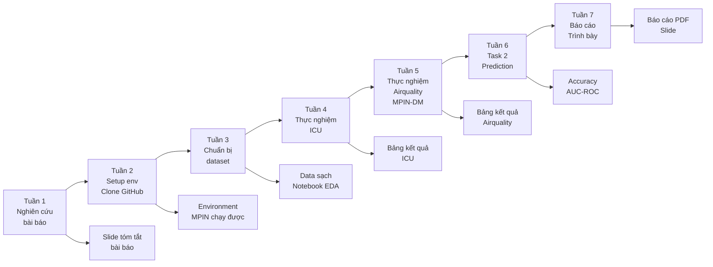

# 04 – Kế Hoạch Dự Án (7 Tuần)

---

## 1. Tổng Quan Lịch Trình

| Tuần | Thời gian | Chủ đề chính | Trạng thái |
|------|----------|-------------|------------|
| 1 | Tuần 1 | Nghiên cứu tài liệu, hiểu bài báo MPIN | Đã lên kế hoạch |
| 2-3 | Tuần 2-3 | Setup môi trường, chạy MPIN từ GitHub, chuẩn bị dataset | Đã lên kế hoạch |
| 4-5 | Tuần 4-5 | Chạy thực nghiệm, so sánh MAE/MRE | Đã lên kế hoạch |
| 6-7 | Tuần 6-7 | Task 2 prediction, báo cáo, trình bày | Đã lên kế hoạch |

---

## 2. Kế Hoạch Chi Tiết Từng Tuần

### Tuần 1 – Nghiên Cứu Tài Liệu

**Mục tiêu**: Toàn nhóm hiểu rõ bài báo MPIN và bối cảnh bài toán.

| Hạng mục | Chi tiết |
|---------|---------|
| **Mục tiêu** | Nắm vững kiến thức nền tảng: GNN, message passing, missing value imputation |
| **Nhiệm vụ** | 1. Đọc bài báo arXiv:2311.07344 từ đầu đến cuối (cả nhóm) |
| | 2. Tóm tắt 4 thách thức C1-C4 bằng ngôn ngữ của nhóm |
| | 3. Vẽ sơ đồ kiến trúc MPIN tay |
| | 4. Đọc paper GraphSAGE (Hamilton et al., 2017) |
| | 5. Nghiên cứu các baseline: BRITS, SAITS, FeaProp |
| | 6. Đọc tài liệu PyTorch Geometric |
| **Deliverables** | - Slide tóm tắt bài báo (10 slides) |
| | - Ghi chú nhóm về 4 thách thức |
| | - Phân công công việc chi tiết |
| **Rủi ro** | Nhóm không hiểu rõ MsgProp → Đọc lại Section 3 bài báo, hỏi GVHD |

---

### Tuần 2 – Setup Môi Trường & Clone GitHub

**Mục tiêu**: Chạy được MPIN từ GitHub gốc trên môi trường local.

| Hạng mục | Chi tiết |
|---------|---------|
| **Mục tiêu** | Setup Python environment, chạy MPIN demo thành công |
| **Nhiệm vụ** | 1. Tạo conda/venv environment với requirements.txt |
| | 2. Clone GitHub: `git clone https://github.com/XLI-2020/MPIN` |
| | 3. Giải quyết dependency conflicts (PyTorch Geometric version) |
| | 4. Chạy MPIN trên sample data từ GitHub |
| | 5. Hiểu cấu trúc code gốc |
| | 6. Bắt đầu tải ICU dataset từ PhysioNet |
| **Deliverables** | - Environment hoạt động (requirements.txt finalized) |
| | - MPIN chạy thành công trên sample data |
| | - Script `download_data.py` hoàn chỉnh |
| **Rủi ro** | Dependency conflict → Dùng Docker container hoặc Google Colab |

---

### Tuần 3 – Chuẩn Bị Dataset

**Mục tiêu**: Dataset ICU và Airquality sẵn sàng cho thực nghiệm.

| Hạng mục | Chi tiết |
|---------|---------|
| **Mục tiêu** | Dữ liệu được tải, tiền xử lý, và kiểm tra chất lượng |
| **Nhiệm vụ** | 1. Tải ICU dataset từ PhysioNet (cần đăng ký tài khoản) |
| | 2. Tải Airquality dataset |
| | 3. Phân tích thống kê: missing rate, phân phối, outlier |
| | 4. Viết `loader.py`: load_icu_dataset, load_airquality_dataset |
| | 5. Viết `preprocessor.py`: normalization, windowing |
| | 6. Notebook `01_data_exploration.ipynb` |
| | 7. Vẽ missing pattern heatmap |
| **Deliverables** | - `data/raw/` chứa đầy đủ dữ liệu |
| | - `data/processed/` chứa dữ liệu đã xử lý |
| | - Notebook khám phá dữ liệu hoàn chỉnh |
| | - Báo cáo thống kê dataset |
| **Rủi ro** | PhysioNet yêu cầu training course → Đăng ký sớm, dùng Airquality trước |

---

### Tuần 4 – Chạy Thực Nghiệm (Baselines + MPIN)

**Mục tiêu**: Có kết quả MAE/MRE cho tất cả phương pháp trên ICU dataset.

| Hạng mục | Chi tiết |
|---------|---------|
| **Mục tiêu** | Bảng kết quả so sánh đầy đủ trên ICU |
| **Nhiệm vụ** | 1. Viết `baselines.py`: MEAN, KNN, FeaProp |
| | 2. Chạy MICE, MF từ scikit-learn |
| | 3. Chạy BRITS (dùng implementation từ GitHub) |
| | 4. Chạy SAITS (dùng pyPOTS library) |
| | 5. Viết `mpin.py`: MsgPropLayer, MPIN class |
| | 6. Chạy MPIN trên ICU, ghi lại MAE/MRE |
| | 7. Viết `metrics.py` và `compare.py` |
| **Deliverables** | - Bảng kết quả ICU (tất cả phương pháp) |
| | - `results/metrics/icu_results.csv` |
| | - Biểu đồ so sánh bar chart |
| **Rủi ro** | MPIN chậm trên CPU → Dùng GPU Colab, giảm batch size |

---

### Tuần 5 – Thực Nghiệm Airquality & MPIN-DM

**Mục tiêu**: Kết quả trên Airquality và test MPIN continuous framework.

| Hạng mục | Chi tiết |
|---------|---------|
| **Mục tiêu** | Bảng kết quả Airquality, demo MPIN-DM streaming |
| **Nhiệm vụ** | 1. Chạy tất cả baseline trên Airquality dataset |
| | 2. Chạy MPIN trên Airquality |
| | 3. Viết `continuous_framework.py`: MPIN-DM |
| | 4. Test MPIN-DM: data_update + model_update |
| | 5. So sánh MPIN vs MPIN-DM về tốc độ và độ chính xác |
| | 6. Phân tích ảnh hưởng của hyperparameter K và η |
| | 7. Notebook `02_mpin_demo.ipynb` |
| **Deliverables** | - Bảng kết quả Airquality |
| | - `results/metrics/airquality_results.csv` |
| | - Demo MPIN-DM chạy thành công |
| | - Phân tích hyperparameter sensitivity |
| **Rủi ro** | MPIN-DM phức tạp → Ưu tiên static MPIN trước nếu thiếu thời gian |

---

### Tuần 6 – Task 2: Prediction

**Mục tiêu**: Dùng dữ liệu đã điền để train classifier ICU.

| Hạng mục | Chi tiết |
|---------|---------|
| **Mục tiêu** | Accuracy và AUC-ROC của ICU mortality prediction |
| **Nhiệm vụ** | 1. Chuẩn bị labels ICU (in-hospital mortality) |
| | 2. Viết `predictor.py`: LogisticPredictor, LSTMPredictor |
| | 3. Train Logistic Regression trên data imputed bởi từng method |
| | 4. Đánh giá: Accuracy, AUC-ROC, F1 |
| | 5. So sánh: imputation method nào cho downstream task tốt hơn |
| | 6. Viết `run_prediction.py` |
| **Deliverables** | - Bảng so sánh prediction accuracy theo imputation method |
| | - `results/metrics/prediction_results.csv` |
| | - Biểu đồ AUC-ROC curves |
| **Rủi ro** | Class imbalance trong ICU labels → Dùng SMOTE hoặc class_weight |

---

### Tuần 7 – Báo Cáo & Trình Bày

**Mục tiêu**: Hoàn thành báo cáo và chuẩn bị trình bày.

| Hạng mục | Chi tiết |
|---------|---------|
| **Mục tiêu** | Báo cáo LaTeX hoàn chỉnh, slide thuyết trình |
| **Nhiệm vụ** | 1. Viết báo cáo đầy đủ (Introduction, Method, Experiment, Conclusion) |
| | 2. Điền số liệu thực tế vào bảng kết quả |
| | 3. Tạo slide thuyết trình (15-20 slides) |
| | 4. Demo live: chạy MPIN trong quá trình thuyết trình |
| | 5. Peer review báo cáo trong nhóm |
| | 6. Nộp final code, cleaned và documented |
| **Deliverables** | - Báo cáo PDF |
| | - Slide thuyết trình |
| | - Final code (GitHub private repo) |
| | - README cập nhật với kết quả thực tế |
| **Rủi ro** | Thiếu thời gian → Ưu tiên các kết quả chính, cắt giảm phân tích phụ |

---

## 3. Sơ Đồ Tiến Độ (Flowchart thay cho Gantt)

---

## 4. Phân Công Vai Trò Thành Viên

| Vai trò | Thành viên | Trách nhiệm chính |
|---------|-----------|-------------------|
| **Member A** | Thành viên A | Setup môi trường, download data, `loader.py`, `preprocessor.py`, `download_data.py` |
| **Member B** | Thành viên B | Cài đặt MPIN: `similarity_graph.py`, `mpin.py`, `continuous_framework.py` |
| **Member C** | Thành viên C | Chạy thực nghiệm: `baselines.py`, `metrics.py`, `compare.py`, `run_imputation.py` |
| **Member D** | Thành viên D | Task 2 + Báo cáo: `predictor.py`, `run_prediction.py`, `plots.py`, báo cáo |

> **Lưu ý**: Mọi thành viên đều tham gia đọc bài báo (Tuần 1) và review kết quả (Tuần 7).

---

## 5. Risk Register (Bảng Rủi Ro)

| # | Rủi ro | Khả năng xảy ra | Mức độ ảnh hưởng | Biện pháp giảm thiểu |
|---|--------|----------------|-----------------|---------------------|
| R1 | PhysioNet yêu cầu training → trễ dataset | Cao | Cao | Đăng ký tài khoản ngay Tuần 1; chuẩn bị Airquality làm backup |
| R2 | Dependency conflict Python/PyTorch | Trung bình | Trung bình | Dùng Docker hoặc Google Colab với GPU |
| R3 | MPIN chạy quá chậm trên CPU | Cao | Cao | Dùng Google Colab Pro / Kaggle GPU; giảm J, T |
| R4 | MPIN-DM quá phức tạp để implement | Trung bình | Trung bình | Ưu tiên static MPIN; MPIN-DM là bonus |
| R5 | Kết quả MPIN không tốt hơn baseline | Thấp | Cao | Kiểm tra lại preprocessing, hyperparameter tuning |
| R6 | Thành viên bị ốm/vắng | Thấp | Trung bình | Cross-training: mỗi thành viên nắm thêm 1 phần của người khác |
| R7 | Dataset Airquality khó tìm nguồn | Trung bình | Thấp | Dùng UCI Air Quality Dataset hoặc AQHI dataset công khai |
| R8 | Thiếu thời gian Tuần 7 | Trung bình | Cao | Bắt đầu viết báo cáo từ Tuần 5; template sẵn từ Tuần 2 |

---

## 6. Công Cụ & Tài Nguyên

| Công cụ | Mục đích |
|---------|---------|
| GitHub (private repo) | Quản lý code |
| Google Colab / Kaggle | Chạy experiment GPU |
| VS Code | IDE |
| Conda/venv | Quản lý môi trường |
| Jupyter Notebook | Khám phá dữ liệu và demo |
| Overleaf (LaTeX) | Viết báo cáo |

---

*Kế hoạch này sẽ được cập nhật hàng tuần dựa trên tiến độ thực tế.*
